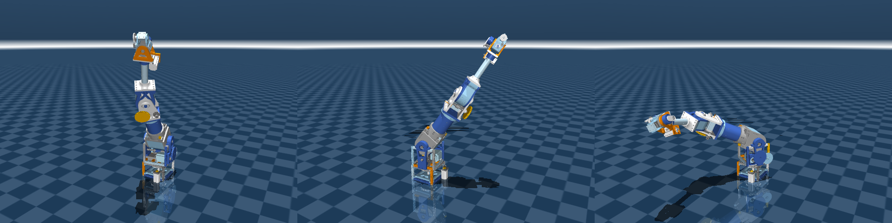

# RL-SwordNet — Plan 1

Plan 1 uses a shared, data-derived skill bank (`Guard`, `Stab`, `ParryUp`) and compares a scripted scheduler with a PPO self-play scheduler for two fixed-base arms. It does **not** implement or compare pure behavior cloning against RL from scratch.

- [中文方案：范围、算法、实验和截至 12 月 3 日的计划](docs/plan1_zh.md)
- [Skill library setup, format, and source notice](motion_skills/plan1/README.md)
- [Pinned source manifest](motion_skills/plan1/manifest.json)

This branch provides the plan, a bounded single-arm baseline, verified source conversion, and an exploratory **floor-mounted arm + shinai motion-matching test**. **The references are not hardware-ready trajectories or trained policies.** Full-CAD collision validation, measured hardware limits, the two-arm environment, scoring, PPO training, and self-play remain pending. Third-party motion binaries and generated trajectories are not redistributed in Git; the library instructions explain how to obtain and verify the pinned sources locally.

## Current setup: floor-fixed arm and first ASE matching test

The current experiment has **no humanoid torso**. The complete original CAD base is fixed to the world in its original upright orientation and translated upward by 8 mm so its measured bottom meets the floor. The arm, transverse near-guard fixture and 1.080 m shinai are not scaled. The actual grip-to-tip distance is 0.790 m. Original XML/meshes and CAD inertias are preserved.

```bash
python -m sim.floor --inspect
```

That command displays the CAD-zero geometry only, not an executed motion or a validated reset-to-guard path. The older shoulder-mounted experiment below is retained for comparison and is not used by the floor test.

After obtaining the verified sources as described in the [skill library instructions](motion_skills/plan1/README.md), run:

```bash
python -m plan1_skills.floor_test --output outputs/floor_matching_round1
```

Use a new/empty output directory for each run. With a Linux EGL renderer, add `--render` and prefix the command with `MUJOCO_GL=egl`. An existing verified source cache can be selected with `--source-dir PATH`; no third-party runtime or unsafe pickle loading is required. To view the generated joint configurations locally:

```bash
python -m plan1_skills.view_match --run outputs/floor_matching_round1 --skill stab
python -m plan1_skills.view_match --run outputs/floor_matching_round1 --skill parry_up
```

These are explicitly labelled **kinematic previews**, not physics playback. Display duration does not specify robot execution timing.

The test applies one common mapping from [config/floor_match.json](config/floor_match.json) to Guard, Stab and ParryUp, using the real mounted grip/tip sites rather than an assumed end-effector axis. It preserves all 128 Stab and 58 ParryUp source frames and adds interpolation (509 and 229 samples respectively). It retains failed samples, checks adjacent joint changes and interpolated proxy contacts, constructs return-to-Guard connections, and reports static gravity demand against the existing provisional torque caps. The source hand displacement is adapted by the pre-existing factor of 0.5; sword and robot dimensions are unchanged.

The first-round full-frame IK screen found a candidate mapping under **hypothetical ±180° joint bounds**; the original tiny debug windows cannot contain it. This is not confirmation of real joint travel. The original animation timing also produces excessive reference joint speeds and must not be used directly. Results in `summary.json` distinguish pose fitting, primitive-contact screening, gravity demand and untested physics. A successful ParryUp fit does not establish that it intercepts an opponent's sword. The start-up motion from CAD zero to Guard remains unvalidated.

For a separate, genuinely forward-stepped **slow diagnostic**, not a kinematic preview:

```bash
python -m sim.floor_playback --input outputs/floor_matching_round1/hypothetical180 --skill both --output outputs/floor_playback_round1
```

This resets directly to Guard, then uses native position actuators with model-gravity feedforward through the **same force caps**. Original gains are preserved (`[2000,2000,2000,2000,200,200,200]`), without external generalized forces or body gravity cancellation. Each saved joint interval is retimed with a stop-to-stop quintic at provisional target bounds of 0.05 rad/s and 0.1 rad/s². The first candidate takes approximately 345 s for Stab and 275 s for ParryUp, including connections and holds, in **simulation time**. This intentionally slow check is not an approved training/combat speed. Output `summary.json` and `trajectory.csv` record actual tracking, complete actuator output, contacts and any failure. Real joint/motor constraints and fast dynamic feasibility remain open.

Local round completed on 2026-11-22: all 509 Stab and 229 ParryUp kinematic samples met the configured error thresholds under the hypothetical range profile (maximum grip fit error 0.100 mm and 0.078 mm, respectively). Both slow forward-step checks completed, with maximum joint tracking errors 0.00582 rad / 0.00363 rad and no proxy penetration, torque saturation or MuJoCo warnings. The checked-in tiny debug-window profile failed pose matching and is not evidence against the data: it was only intended for small joint demos. These results do not validate real joint travel, source-speed execution, full CAD contacts, start-up travel or opponent interception.

## Single-arm baseline

A CAD-derived, fixed-base arm model with seven simulated hinge joints (`J0`–`J6`). The first milestone is a model audit and a bounded, low-speed single-arm demonstration. The long-term project goal is two fixed robots and sim-to-real evaluation.



This repository is not yet a sword-fighting or RL environment. A separate generated single-arm sword assembly is now available below; match/contact rules, hardware calibration, and robot skill retargeting remain pending. See [model status and remaining inputs](docs/model_status.md) for the original baseline; [Plan 1](docs/plan1_zh.md) supersedes the earlier online Cartesian-policy/Pinocchio roadmap.

## Earlier shoulder-mounted shinai assembly (not the current floor setup)

The complete CAD base is side-mounted to the right shoulder of a fixed humanoid upper body. A short collar grips the shinai 31 mm below the guard, with its axis **parallel to the measured four-hole face**, not inserted along the face normal. The original CAD XML/meshes and arm scale are preserved. This is a **simulation fixture, not a manufacturing-ready clamp**; there are still seven DOFs and no grasp actuator.

```bash
python -m sim.inspect_mount --output outputs/mount_inspection
python -m sim.assembly --headless --output outputs/assembly
```

For a static viewer that stays open until closed, run `python -m sim.assembly --inspect`. For an interactive physics check, run `python -m sim.assembly`. To save images on a Linux EGL setup, use `MUJOCO_GL=egl python -m sim.assembly --headless --output outputs/assembly --snapshot`.

The default check initializes a near-horizontal, forward-pointing sword, selects a model-gravity-balanced J0 initial angle and completes a 10-second hold/small-J6 out-and-back under the existing provisional joint and torque bounds. It writes an independent scene, trajectory and pass/fail evidence to `outputs/assembly/`; it does not validate the CAD-zero-to-home path or fencing skills. Static inspection is not a physics test. When opening the generated XML directly, select the `assembly_home` keyframe; the Python entry point handles this initialization and gravity-compensated control. [中文装配说明、测量依据与限制](docs/assembly_zh.md) distinguishes measured interface dimensions from assumed fixture, mass and runtime values.

## Run the audit and demo

Run these commands from the repository root:

```bash
python -m pip install -r requirements.txt
python -m sim.audit --output outputs/model_audit.json
python -m sim.demo --headless --output outputs/joint_demo
```

The audit inspects the original `scene.xml`; it does not apply the demo configuration. The demo applies `config/debug.json` to the loaded model in memory and leaves the source XML unchanged.

To save a rendered snapshot, add `--snapshot` (requires a working MuJoCo rendering backend):

```bash
python -m sim.demo --headless --output outputs/joint_demo --snapshot outputs/joint_demo/preview.png
```

On a Linux server without a display, select an available backend before Python starts, for example `MUJOCO_GL=egl python -m sim.demo --headless --snapshot outputs/joint_demo/preview.png`. The physics-only headless run does not require a graphics context.

To open the interactive viewer, omit `--headless`:

```bash
python -m sim.demo --config config/debug.json --output outputs/joint_demo
```

The default demo lasts 30 simulated seconds: one second of initial hold, a four-second cosine out-and-back motion for each of the seven joints, then one second of final hold. Each motion has an amplitude of `0.025 rad` relative to the CAD pose. Physics runs at `0.002 s` and control at `0.01 s`.

Outputs are `trajectory.csv` and `summary.json`. They record joint position, velocity, trajectory target, actual actuator torque at each joint, and the world position of the **`end_effector_block` body origin**. That body origin is not a sword tip or a calibrated tool frame.

The demo uses the existing position actuators and offsets their targets to compensate for gravity computed by the model. The same actuator torque caps constrain both tracking and gravity compensation. This checks the configured simulation; it does not establish that the real motors can perform the motion.

## Debug limits

All values below are development settings, **not measured hardware specifications**:

| Setting | Default |
| --- | --- |
| Joint software window about the CAD pose | J0: ±0.10 rad; J1–J6: ±0.15 rad |
| Actuator torque caps, J0–J6 | `[5, 80, 15, 20, 3, 3, 2]` Nm |
| Target speed limit | 0.05 rad/s |
| Measured joint speed monitoring threshold | 0.5 rad/s |
| Joint tracking-error monitoring threshold | 0.1 rad |

The raw XML has no joint range or actuator torque limits. Use the configured demo for the bounded motion check; opening the raw XML in a viewer does not apply these settings.

## Files and checks

- `robot.xml`: the original seven-joint arm and CAD inertial parameters.
- `scene.xml`: the original arm scene, floor, and lighting.
- `meshes/`: CAD STL assets; the repository describes their units as meters.
- `config/debug.json`: provisional runtime settings for the low-speed demo.
- `sim/`: model-loading, audit, and demonstration tools.
- `docs/model_status.md`: assumptions, limitations, and required project inputs.

```bash
python -m unittest discover -s tests -v
```

For the original viewer-only workflow:

```bash
python -m mujoco.viewer --mjcf=scene.xml
```

On Windows, `view.bat` opens that original scene. It does not run the configured demo.

## Current model limitations

- The XML models seven independently actuated joints; the real independent degrees of freedom and any mechanical coupling still need confirmation.
- Moving mass is `26.532377 kg`, derived from the model's CAD inertial parameters. Printed-part masses, centers of mass, and inertias need calibration.
- `qpos = 0` is the CAD pose, not a confirmed encoder zero or vertical-sword pose.
- All original robot meshes are visual only. The separate assembly adds coarse collision proxies; full-CAD contact validation and scoring are not implemented.
- Raw actuator gains, damping, and armature are placeholders. Transmission ratios and measured motor behavior are not modeled.
- The original scene has no sword/tool sites. The separate assembly adds a proposed grip/tool transform, not a calibrated real installation. Source URDF, Pinocchio IK, perception, RL training and trained-policy evaluation are not included.
