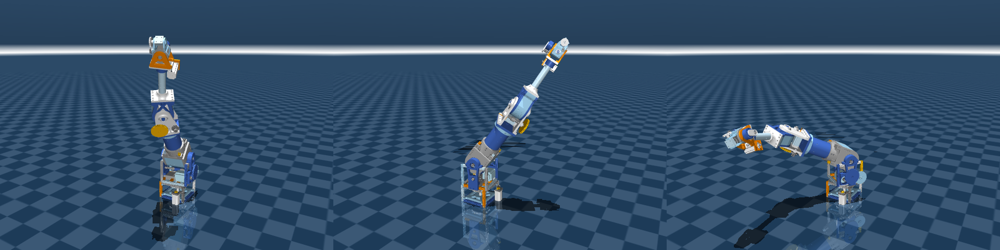

# RL-SwordNet A1 historical development notes

Archived on the `plan2` branch, 23 November 2026. Start with [the current Plan 2 README](README.md). The commands and results below retain their original configuration and limitations; they are not admission evidence for the revised joint limits, multi-region scoring, or A2. The former remote `A1` branch is not required: historical code is included in this branch.

**23 November joint-limit revision:** the newly confirmed angle ranges invalidate the old v5 common Guard and its training-bank compatibility. The v5 quick-start/training results below are retained as historical reproduction under the former ±π assumption; do not treat them as a current hardware-constrained training configuration. New named-guard and continuous-motion candidates are implemented separately in `sim.a1_flow`, but are not a complete replacement training library. See [the current requirements, continuity diagnosis and remaining failures](docs/a1_motion_revision_zh.md).

```bash
python -m sim.a1_flow --output outputs/a1_named_flow_new
```

This audits the ten interpreted stationary targets and their connections using the confirmed ranges. It keeps failed targets and connections, performs no training, and reports candidate status rather than silently changing the old bank.

The opt-in confirmed-limit **two-arm native trial** now lives in `sim.limited_duel` and `sim.constrained_trial`. Its matched full-window defence checks are in `sim.constrained_validation`. One adjusted attack/parry pair passes full 7.5-second windows in both roles, while late and wrong-direction controls are hit. This earlier scheduled pair used different attack/defence ready states; it is not a trained policy or an admitted shared action bank. See [native combat checks, preserved failures and the execution interface](docs/a1_native_combat_zh.md).

The follow-up `sim.feedback_trial` tests current-observation responses and measured skill-graph readiness. A new **shared-ready glancing parry** passes a 12-second matched attack control, mirrored roles, an 18-second two-strike rearming check, and a 14-second parry/counter/response chain. Wrong-side and late controls are hit. Diagnostic truncation is now reported separately from physical failure, with unfinished actions and recovery recorded explicitly. These are bounded, non-learning tests of **one attack direction**, not a complete or admitted training bank; see [the full-chain results, preserved failures and remaining gates](docs/a1_feedback_validation_zh.md). The reproducible waypoint seed is [here](config/a1_shared_ready_glancing_seed.json); it does not replace the old five-action training interface.

The [action coverage audit and direction expansion](docs/a1_action_coverage_zh.md) separates the ten requested guards/five named cuts from functional attacks. Two new shared-ready vertical sweeps pass native hit-and-recovery controls. A new low parry blocks the upward sweep at one tested timing, but a slower retiming loses despite faster measured recovery; the high parry touches the downward sweep but fails to prevent its hit. Neither is a robust training admission. A later-start sample of the original parry also causes a contact-penetration failure. [Candidate graph loading](sim/candidate_graph.py) validates the new explicit curves without granting training admission or replacing the legacy actor.

This `A1` branch packages the finite-skill side of the fencing project: two original-size, floor-fixed arms holding 1.080 m shinai, a simultaneous MuJoCo environment, a five-action neural chooser, frozen historical opponents and bounded PPO updates. **It is a development training pipeline, not an already-skilled fencing policy or a hardware-safe controller.**

A1 selects **Guard / Stab / SlashLeft / ParryLeft / ParryRight** and learns when to start them. The future A2 family will learn continuous seven-joint target increments; it is not implemented here. Lowercase `a1` and `a2` in logs are the two physical slots, both running A1-family policies during this self-play.

## Quick start

Run from the repository root. Linux/Python 3.13.11 with MuJoCo 3.4.0, NumPy 2.5.4 and Torch 2.7.0 was used for the recorded checks. CPU execution is supported; no Isaac Gym, Stable-Baselines3 or GPU is required. Other platforms have not been validated. These are the tested versions, not a promise of bit-identical reconstruction with arbitrary dependency versions.

```bash
git clone --branch A1 --single-branch https://github.com/Wea3el/RL-SwordNet.git
cd RL-SwordNet
python -m venv .venv
source .venv/bin/activate
python -m pip install --upgrade pip
python -m pip install torch==2.7.0 --index-url https://download.pytorch.org/whl/cpu
python -m pip install -r requirements-a1.txt
```

The CPU wheel index follows [PyTorch's versioned installation instructions](https://pytorch.org/get-started/previous-versions/#v270). The base dependencies remain in `requirements.txt`; the learner additionally requires Torch. For visualization only, install `imageio` and `imageio-ffmpeg` separately.

### 1. Prepare the local skill bank

The Git branch contains source code, robot meshes, configuration, authored defence recipes and a reference fingerprint. It deliberately does **not** redistribute upstream motion binaries or generated motion arrays. Read [the source notice](motion_skills/plan1/SOURCES.md) and the [upstream motion README](https://github.com/nv-tlabs/ASE/blob/6f9b4f1f289603eee6a4f45d082bc6e6d83fecec/ase/data/motions/reallusion_sword_shield/README.txt) before obtaining data for your intended use.

Put these five files from pinned ASE commit `6f9b4f1f289603eee6a4f45d082bc6e6d83fecec` into `outputs/ase_sources/`. These links point to the exact source files; filenames, byte counts and SHA-256 digests are checked against [the source manifest](config/ase_pilot_v2.json).

- [RL_Avatar_Idle_Ready_Motion.npy](https://raw.githubusercontent.com/nv-tlabs/ASE/6f9b4f1f289603eee6a4f45d082bc6e6d83fecec/ase/data/motions/reallusion_sword_shield/RL_Avatar_Idle_Ready_Motion.npy)
- [RL_Avatar_Atk_Stab_Motion.npy](https://raw.githubusercontent.com/nv-tlabs/ASE/6f9b4f1f289603eee6a4f45d082bc6e6d83fecec/ase/data/motions/reallusion_sword_shield/RL_Avatar_Atk_Stab_Motion.npy)
- [RL_Avatar_Atk_SlashLeft_Motion.npy](https://raw.githubusercontent.com/nv-tlabs/ASE/6f9b4f1f289603eee6a4f45d082bc6e6d83fecec/ase/data/motions/reallusion_sword_shield/RL_Avatar_Atk_SlashLeft_Motion.npy)
- [RL_Avatar_Sword_ParryLeft_Motion.npy](https://raw.githubusercontent.com/nv-tlabs/ASE/6f9b4f1f289603eee6a4f45d082bc6e6d83fecec/ase/data/motions/reallusion_sword_shield/RL_Avatar_Sword_ParryLeft_Motion.npy)
- [RL_Avatar_Sword_ParryRight_Motion.npy](https://raw.githubusercontent.com/nv-tlabs/ASE/6f9b4f1f289603eee6a4f45d082bc6e6d83fecec/ase/data/motions/reallusion_sword_shield/RL_Avatar_Sword_ParryRight_Motion.npy)

```bash
python -m sim.a1_prepare --source-dir outputs/ase_sources --output outputs/a1_prepared
```

This runs offline source verification, calibrated IK, the recorded authored Slash adaptation and the Right25/Left30 defence recipes. The final bank is `outputs/a1_prepared/library`. Source arrays remain local and are decoded through the restricted numeric reader, not `pickle.load`. Rebuilding takes longer than simply loading a bank and may fail if the local numerical result does not match the checked reference; a different result must not silently inherit prior physical validation. Only continue when `prepare_report.json` has `status="complete"` and `numeric_matches_validated_v5=true`; a failed run may leave intermediate files that are not approved for use. The packaged builder has been run from the five local source files and reproduced all five reference curves exactly on the tested system.

Use a new output directory for every command below. Never overwrite failed evidence. Team members who already have the locally validated v5 bank may pass its existing directory instead; the training run records its actual identity.

### 2. Run a zero-update check

```bash
python -m sim.a1_selfplay \
  --bank outputs/a1_prepared/library \
  --runtime-profile config/a1_runtime_rk4_candidate.json \
  --output outputs/a1_zero_check --episodes 2 --seed 20261122
```

This only samples two complete games against a frozen initial policy. It verifies action masks, real decision rows, unchanged weights and log-probability replay; it does not optimize the network.

### 3. Run bounded minimal self-play training

```bash
python -m sim.a1_train \
  --bank outputs/a1_prepared/library \
  --runtime-profile config/a1_runtime_rk4_candidate.json \
  --output outputs/a1_train_small \
  --updates 2 --episodes-per-update 2 --seed 20261122
```

The default experiment is four games and two updates, not an unattended long run. Each game is at most 80 simulated seconds. The CLI enforces finite budgets: at most eight updates, two to eight games per update in an even count, and at most 32 games total. It alternates the learner's physical slot, samples a frozen opponent before each game, keeps that opponent fixed throughout the game, performs one on-policy full-batch PPO update, and adds the resulting learner snapshot to a pool of at most four versions. Adam state persists across updates. There is no automatic resume or budget expansion.

A numerical, controller or contact-evidence error stops the batch and saves the invalid episode. It is **not** converted to a draw, dropped and retried, or used for a partial-batch update. Initial, per-update and final candidate checkpoints, RNG state, configuration, source hashes, per-game decisions and native trajectories are written under the selected output directory. Only load checkpoints you trust. A saved checkpoint is not proof of a stronger policy.

### 4. Run the tests

```bash
OMP_NUM_THREADS=1 MKL_NUM_THREADS=1 python -m unittest discover -s tests -q
```

Tests do not need the ASE cache to exercise the learner/environment contracts. Rebuilding the real bank and running the full robot are separate integration checks. Test counts and actual recorded native evidence are listed in [A1 validation status](docs/a1_readiness_zh.md).

## Algorithm and physics contract

- **Observations:** own seven joint angles/velocities, current opposing sword tip/grip positions and tip velocity in the observer's frame, plus own executor state. No opposing skill ID, future trajectory, absolute episode clock or opponent checkpoint identity is supplied to the policy.
- **Actions:** a masked five-action policy with two 64-unit Tanh layers and a value head. A chosen skill runs until it returns to a measured legal Guard state; busy continuation frames are not actor choices. Guard while ready is a real, learnable wait action.
- **Returns:** variable-duration transitions, `gamma(dt)=exp(-dt/120 seconds)`, complete-episode Monte Carlo targets. The 80-second game limit is a zero-reward draw, not a continuing-task bootstrap. Initial stochastic Guard bias leaves time to observe an opponent; greedy argmax on an untrained policy is not a meaningful evaluation.
- **Scoring:** actual whole-blade entry into a fixed target, not direction labels. Blade/guard contacts are neutral. Approved motion-based foul attribution precedes hits within the same physics tick; ambiguous/both-active fouls give both sides −1. Error states produce no ordinary reward.
- **Shared model:** RK4, 1 ms physics, 10 ms low-level control, 20 ms decisions; unchanged fixed-base arm and sword dimensions. Joint travel, torque and contact parameters are developmental estimates. `2 rad/s` is recorded as a diagnostic, not guaranteed by this branch.

The current skills mix ASE-derived attack seeds with authored spatial/timing adaptations and authored parries. This is **not** end-to-end imitation learning from an expert fencing dataset. Limited validated attacks/parries do not guarantee protection against arbitrary A2 trajectories. In particular, long non-interruptible skills, sparse wins and mutual-defense draws remain learning risks.

## Evidence and project documentation

Recorded work before this packaging includes continuous attack/parry regressions, wrong-direction controls, eight constant/random-policy screening games, two valid frozen-policy native games and one PPO optimizer smoke over 510 real learner decisions. The initial games produced one timeout and one learner loss; no learned fencing performance is claimed. Full local trajectories are not committed. The compact [verification manifest](docs/a1_verification.json) preserves the measured outcomes and their source hashes without distributing motion data.

Release checks on 23 November 2026 also reproduced the five-skill bank from source and ran the public training CLI for **one update over two native games**. Those games yielded 453 learner decisions, one target loss and one double foul; the update had finite gradients and saved two distinct snapshots. The full local suite passed 411 tests. A clean archive with no ASE cache passed its available tests (407 run, two source-dependent fixtures skipped). These checks verify packaging and the training path, not improved fencing performance; the default two-update experiment has not been evaluated as a learned policy.

- [中文采样与更新说明](docs/a1_training_zh.md)
- [中文物理验证、训练状态和剩余风险](docs/a1_readiness_zh.md)
- [动作来源与重定时](docs/a1_execution_zh.md)
- [犯规归责及限制](docs/foul_attribution_zh.md)
- [整个项目的 A1/A2 研究方案](docs/plan1_zh.md)

## Earlier Plan 1 history

The sections below retain earlier model and report history. Their dated candidate results do not override the current A1 instructions above. The original `plan1` and `main` branches are not modified by this branch's publication.

## Report entry points

- [English preliminary report draft](docs/report_draft_en.md): repository, description, tools, algorithms, planned work/experiments, expected results, preliminary work and ethics.
- [当前中文项目框架与报告说明](docs/plan1_zh.md)：最新 A1/A2 双 self-play 主线及截至 12 月 3 日的计划。
- [Current validation status and limitations](docs/skill_validation_zh.md): distinguishes geometric candidates, physical controls and work still required before RL.
- [A1 finite-skill executor and reproduction](docs/a1_execution_zh.md): closed joint paths, measured own-state entry/exit gates and native whole-window tests.
- [A1 当前动作验证和训练环境进度](docs/a1_readiness_zh.md)：连续攻防回归、退化策略筛查、两局真实采样和一次更新测试。
- [A1 采样与更新接口](docs/a1_training_zh.md)：观测、变时长决策、冻结对手和有界零更新入口。
- [A1 authored defence construction and evidence](docs/a1_defence_zh.md): observation-triggered Stab interceptions, conditional fine-timestep Slash blocks, and remaining stability/coverage gaps.
- [Offline foul attribution evidence](docs/foul_attribution_zh.md): pre-impact point-motion evidence and ambiguity handling; the approved convention is now opt-in in the new development environment, without rewriting historical scoring.

Updated 22 November 2026. Use the current documents for the report; the [21 November plan](docs/plan1_20261121_zh.md) is retained as history and its fixed-script/shared-three-skill comparison is superseded. No trained fencing policy or defence against arbitrary attack trajectories is claimed.

The confirmed research goal is **two separately self-play-trained policies** on unchanged floor-fixed arms: A1 selects and times finite predefined skills, while A2 outputs continuous joint-target increments. They must share physical observations, native low-level control and scoring rules, then be frozen for cross-play. A1's neural chooser, decision-only collector, frozen opponent pool and bounded training loop are implemented. The original 510-row optimizer smoke and later public CLI check establish data/update plumbing, not learned fencing. A2 and a frozen policy comparison remain pending.

Full-window **physical attack/parry validation** remains the prerequisite for each admitted skill. Current finite-bank tests include two attack directions, matching parries and a winning counterattack, followed by new-environment regressions and negative controls. Opt-in `whole_blade_first_touch_v2` scores the actual three finite blade cylinders without skill/phase labels; blade-to-guard contact is neutral legal weapon contact. The first-touch game result is separate from later diagnostic target entries, so a contacted parry cannot hide a delayed hit. Historical v1 rules and failed evidence remain unchanged. The manually authored shared three-skill fixture and earlier ASE conversion below are controls, not the final A1 bank or trained policies. See [acceptance requirements, evidence and reproduction](docs/skill_validation_zh.md).

- [中文动作定义、成对物理验证、时序边界及复现方法](docs/manual_duel_zh.md)
- [共享技能有效性验证与连续反击阻塞项](docs/skill_validation_zh.md)
- [完整 ASE 直刺和上拨挡的双机测试与适配结果](docs/ase_duel_zh.md)
- [中文方案：范围、算法、实验和截至 12 月 3 日的计划](docs/plan1_zh.md)
- [Skill library setup, format, and source notice](motion_skills/plan1/README.md)
- [Pinned source manifest](motion_skills/plan1/manifest.json)

This branch provides a bounded single-arm baseline, earlier source conversion/matching tests, versioned two-arm native-contact skill diagnostics, and A1 development sampling/update interfaces. **The references are not hardware-ready trajectories or trained policies.** Measured hardware limits, broad contact/trajectory coverage, continuing self-play training, A2 continuous control and final cross-play evaluation remain pending. Third-party motion binaries and generated trajectories are not redistributed in Git.

## Shared skill validation before RL

Historical v1 diagnostic:

```bash
python -m sim.skill_validation --output outputs/shared_new --library-config config/shared_skills_staged_candidate.json --offsets -6 -5 -3 -2.5 -2 -1.5 0 2 3
python -m sim.policy_validation --output outputs/policies_new --library-config config/shared_skills_staged_candidate.json --duration-s 60
MUJOCO_GL=egl python -m sim.skill_validation_replay --run outputs/shared_new --baseline a1_attack_guard --defended a1_parry_offset_-2.00 --output outputs/shared_new/comparison.mp4 --start-s 8 --end-s 17
```

Explicit whole-blade v2 diagnostic, with a 20 ms decision tick and neighbouring parry start samples:

```bash
python -m sim.skill_validation --output outputs/whole_blade_v2_new --library-config config/shared_skills_staged_candidate.json --rules whole_blade_first_touch_v2 --decision-period-s .02 --offsets -5 -2.1 -2.05 -2 -1.95 -1.9 2
```

Even a successful sampled window is not a universal parry guarantee. Every final A1 skill must have a real hitting Guard control, full-window defence evidence, timing/direction negative controls, and tested entry/exit transitions. Merely choosing the matching direction never grants immunity.

Use new output paths. The staged manual candidate keeps the 1.080 m sword, original arm dimensions, fixed targets, collision masks and debug torque caps unchanged. It separates upright preparation from sword rotation. Speed/tracking are diagnostics in this pose-first stage, not hardware certification. The shared manual builder's default deliberately retains the earlier simultaneous-preparation candidate; select its staged configuration explicitly. Every output includes failed cases; a successful scheduled parry is not a validated continuous game or autonomous-policy comparison.

## A1 ASE derived five skill geometry pilot

`A1` denotes the finite-skill policy family, not the left `a1` scene slot. A1-family policies may occupy both robot slots during their own self-play; this candidate library does not constrain A2's continuous joint-command action space. Configs and future exports explicitly carry `policy_family=A1`. The present candidates do not establish multi-directional defence or a trainable self-play environment.

This pilot requires the five exact source files listed in `config/ase_pilot_v2.json`, obtained separately under the source terms and kept in a local cache. Use `--source-dir PATH` for that cache; missing/corrupt files are rejected without automatic download. The historical `plan1_skills fetch` command obtains only its two older sources, not the new five-source pilot.

```bash
python -m sim.ase_pilot --config config/ase_pilot_v2_calibrated_candidate.json --output outputs/ase_pilot_new --ik
```

This local-cache-only candidate contains Ready, Stab, a horizontal slash and left/right parry seeds, with pinned source hashes, selected frames, authored seams and retiming recorded. The calibrated common mapping passes the sampled actual-model IK and strict proxy-contact screen for all five candidates. **Dynamic attacks, interceptions, joint-loop recovery and continuous switching are not certified; no candidate is admitted to training.** An independent joint-return diagnostic found geometrically clear paths, but some move the sword tip substantially and must be included in full-window defence tests. The original failed mapping and all calibration attempts are retained; see the [current evidence](docs/skill_validation_zh.md).

The later `sim.a1_skills` builder closes every joint loop explicitly and `sim.a1_control` waits for measured Guard settling before admitting another skill. `sim.a1_validation` tests native execution, transitions and paired opportunities without phase-gated scoring or post-initialization joint resets. These are candidate-validation tools, not trained selectors. See [commands and acceptance gates](docs/a1_execution_zh.md).

Local native checks establish a hitting Stab and an explicitly authored enhanced Slash against Guard in both slots. The original Slash misses, and the original parries failed all 11 tested attack/timing combinations. A later **26-second authored upright parry** now prevents two repeated Stabs after a current 1 mm tip-motion cue, including mirrored delayed starts and a 1 ms repeat. A directional advance/downward cue also passes a fresh two-Stab control; generic motion alone must not preempt the later Left/Right choice. Earlier scheduled successes are not relabelled as autonomous reaction. A legal defence/counter/defence continuation exists, but its counter loses the first touch by 0.3 s.

A vertical Left has now blocked Slash over full 40 s windows at explicit **1 ms and 0.5 ms** physical steps, using a public motion cue. Its old 2 ms trial still fails penetration, and actual trajectories remain timestep-sensitive despite similar first-hit times at the finer settings. The global 2 ms default is unchanged; the mixed Left/Right bank is still a candidate, not approved for full training. The optional `sim.a1_adaptation` and `sim.a1_defence` preserve original source arrays, while `sim.a1_reaction_validation` reproduces the restricted Stab/Right diagnostic with fixed expected action counts. See [versions, failures and reproduction](docs/a1_defence_zh.md). This is not learned self-play, general A2 coverage or hardware certification.

Later checks explicitly use a new RK4/1 ms profile and Right25/Left30 bank. Fresh paired controls pass both Stab→Slash and Slash→Stab over complete 80 s windows, with independently checked pre-hit interception for each attack and completed returns. A separate 80 s diagnostic blocks the first Stab and counterattacks for a real first-touch win by 0.22 s. RK4 1/0.5 ms full Slash contact comparisons also pass; these are fixed-case physical opportunities, not learned self-play or universal A2 defence. The opt-in simultaneous A1-only environment integrates the approved foul convention. A neural chooser, frozen opponent pool, decision-only sampling and bounded training loop are implemented; learned performance and the A2 continuous adapter remain pending. See [current results and environment reproduction](docs/a1_readiness_zh.md). Historical paragraphs above retain their own settings and evidence.

## Earlier role-specific manual attack and parry test

```bash
python -m sim.manual_duel --output outputs/manual_duel_new --matrix
MUJOCO_GL=egl python -m sim.manual_duel_replay --run outputs/manual_duel_new --output outputs/manual_duel_new/comparison.mp4
```

Use a new output path. Physics-only testing needs the existing requirements; optional MP4 rendering also needs `imageio` and `imageio-ffmpeg`. The replay uses recorded physics states, not command trajectories.

The default attack hits without defence, while the correctly timed active side-parry prevents the hit throughout 11.85 simulated seconds. Mirrored roles and a 1 ms timestep repeat the result; a deliberately late parry fails. Timing/speed sensitivity tests also contain genuine failures: this is a controlled example, **not universal defence or an RL win rate**. Original dimensions/gains/torque caps are unchanged; joint travel remains hypothetical. See the [full evidence and limitations](docs/manual_duel_zh.md).

## Earlier floor-fixed ASE matching test

The later full-clip physical experiment is described in [ASE duel testing](docs/ase_duel_zh.md): `python -m sim.ase_duel --output outputs/ase_original_new`. Both full clips play once with separate guard connections. The original display mapping misses the target; common spatial calibration produces a real native-clip thrust hit, but tested ParryUp timings have not established valid defence. This is geometry-preserving retimed playback, not source-speed imitation or a trained policy.

The current experiment has **no humanoid torso**. The complete original CAD base is fixed to the world in its original upright orientation and translated upward by 8 mm so its measured bottom meets the floor. The arm, transverse near-guard fixture and 1.080 m shinai are not scaled. The actual grip-to-tip distance is 0.790 m. Original XML/meshes and CAD inertias are preserved.

```bash
python -m sim.floor --inspect
```

That command displays the CAD-zero geometry only, not an executed motion or a validated reset-to-guard path. The older shoulder-mounted experiment below is retained for comparison and is not used by the floor test.

After obtaining the verified sources as described in the [skill library instructions](motion_skills/plan1/README.md), run:

```bash
python -m plan1_skills.floor_test --output outputs/floor_matching_round1
```

Use a new/empty output directory for each run. With a Linux EGL renderer, add `--render` and prefix the command with `MUJOCO_GL=egl`. An existing verified source cache can be selected with `--source-dir PATH`; no third-party runtime or unsafe pickle loading is required. To view the generated joint configurations locally:

```bash
python -m plan1_skills.view_match --run outputs/floor_matching_round1 --skill stab
python -m plan1_skills.view_match --run outputs/floor_matching_round1 --skill parry_up
```

These are explicitly labelled **kinematic previews**, not physics playback. Display duration does not specify robot execution timing.

The test applies one common mapping from [config/floor_match.json](config/floor_match.json) to Guard, Stab and ParryUp, using the real mounted grip/tip sites rather than an assumed end-effector axis. It preserves all 128 Stab and 58 ParryUp source frames and adds interpolation (509 and 229 samples respectively). It retains failed samples, checks adjacent joint changes and interpolated proxy contacts, constructs return-to-Guard connections, and reports static gravity demand against the existing provisional torque caps. The source hand displacement is adapted by the pre-existing factor of 0.5; sword and robot dimensions are unchanged.

The first-round full-frame IK screen found a candidate mapping under **hypothetical ±180° joint bounds**; the original tiny debug windows cannot contain it. This is not confirmation of real joint travel. The original animation timing also produces excessive reference joint speeds and must not be used directly. Results in `summary.json` distinguish pose fitting, primitive-contact screening, gravity demand and untested physics. A successful ParryUp fit does not establish that it intercepts an opponent's sword. The start-up motion from CAD zero to Guard remains unvalidated.

For a separate, genuinely forward-stepped **slow diagnostic**, not a kinematic preview:

```bash
python -m sim.floor_playback --input outputs/floor_matching_round1/hypothetical180 --skill both --output outputs/floor_playback_round1
```

This resets directly to Guard, then uses native position actuators with model-gravity feedforward through the **same force caps**. Original gains are preserved (`[2000,2000,2000,2000,200,200,200]`), without external generalized forces or body gravity cancellation. Each saved joint interval is retimed with a stop-to-stop quintic at provisional target bounds of 0.05 rad/s and 0.1 rad/s². The first candidate takes approximately 345 s for Stab and 275 s for ParryUp, including connections and holds, in **simulation time**. This intentionally slow check is not an approved training/combat speed. Output `summary.json` and `trajectory.csv` record actual tracking, complete actuator output, contacts and any failure. Real joint/motor constraints and fast dynamic feasibility remain open.

Local round completed on 2026-11-22: all 509 Stab and 229 ParryUp kinematic samples met the configured error thresholds under the hypothetical range profile (maximum grip fit error 0.100 mm and 0.078 mm, respectively). Both slow forward-step checks completed, with maximum joint tracking errors 0.00582 rad / 0.00363 rad and no proxy penetration, torque saturation or MuJoCo warnings. The checked-in tiny debug-window profile failed pose matching and is not evidence against the data: it was only intended for small joint demos. These results do not validate real joint travel, source-speed execution, full CAD contacts, start-up travel or opponent interception.

## Single-arm baseline

A CAD-derived, fixed-base arm model with seven simulated hinge joints (`J0`–`J6`). The first milestone is a model audit and a bounded, low-speed single-arm demonstration. The long-term project goal is two fixed robots and sim-to-real evaluation.



This original single-arm baseline and the earlier manual two-arm fixture are not themselves RL environments. The newer A1 development environment and sampling/update interfaces are described above; learned policies, A2 continuous control and hardware calibration remain pending. See [model status and remaining inputs](docs/model_status.md) for the original baseline; the earlier [ASE Plan 1](docs/plan1_20261121_zh.md) remains documented for comparison.

## Earlier shoulder-mounted shinai assembly (not the current floor setup)

The complete CAD base is side-mounted to the right shoulder of a fixed humanoid upper body. A short collar grips the shinai 31 mm below the guard, with its axis **parallel to the measured four-hole face**, not inserted along the face normal. The original CAD XML/meshes and arm scale are preserved. This is a **simulation fixture, not a manufacturing-ready clamp**; there are still seven DOFs and no grasp actuator.

```bash
python -m sim.inspect_mount --output outputs/mount_inspection
python -m sim.assembly --headless --output outputs/assembly
```

For a static viewer that stays open until closed, run `python -m sim.assembly --inspect`. For an interactive physics check, run `python -m sim.assembly`. To save images on a Linux EGL setup, use `MUJOCO_GL=egl python -m sim.assembly --headless --output outputs/assembly --snapshot`.

The default check initializes a near-horizontal, forward-pointing sword, selects a model-gravity-balanced J0 initial angle and completes a 10-second hold/small-J6 out-and-back under the existing provisional joint and torque bounds. It writes an independent scene, trajectory and pass/fail evidence to `outputs/assembly/`; it does not validate the CAD-zero-to-home path or fencing skills. Static inspection is not a physics test. When opening the generated XML directly, select the `assembly_home` keyframe; the Python entry point handles this initialization and gravity-compensated control. [中文装配说明、测量依据与限制](docs/assembly_zh.md) distinguishes measured interface dimensions from assumed fixture, mass and runtime values.

## Run the audit and demo

Run these commands from the repository root:

```bash
python -m pip install -r requirements.txt
python -m sim.audit --output outputs/model_audit.json
python -m sim.demo --headless --output outputs/joint_demo
```

The audit inspects the original `scene.xml`; it does not apply the demo configuration. The demo applies `config/debug.json` to the loaded model in memory and leaves the source XML unchanged.

To save a rendered snapshot, add `--snapshot` (requires a working MuJoCo rendering backend):

```bash
python -m sim.demo --headless --output outputs/joint_demo --snapshot outputs/joint_demo/preview.png
```

On a Linux server without a display, select an available backend before Python starts, for example `MUJOCO_GL=egl python -m sim.demo --headless --snapshot outputs/joint_demo/preview.png`. The physics-only headless run does not require a graphics context.

To open the interactive viewer, omit `--headless`:

```bash
python -m sim.demo --config config/debug.json --output outputs/joint_demo
```

The default demo lasts 30 simulated seconds: one second of initial hold, a four-second cosine out-and-back motion for each of the seven joints, then one second of final hold. Each motion has an amplitude of `0.025 rad` relative to the CAD pose. Physics runs at `0.002 s` and control at `0.01 s`.

Outputs are `trajectory.csv` and `summary.json`. They record joint position, velocity, trajectory target, actual actuator torque at each joint, and the world position of the **`end_effector_block` body origin**. That body origin is not a sword tip or a calibrated tool frame.

The demo uses the existing position actuators and offsets their targets to compensate for gravity computed by the model. The same actuator torque caps constrain both tracking and gravity compensation. This checks the configured simulation; it does not establish that the real motors can perform the motion.

## Debug limits

All values below are development settings, **not measured hardware specifications**:

| Setting | Default |
| --- | --- |
| Joint software window about the CAD pose | J0: ±0.10 rad; J1–J6: ±0.15 rad |
| Actuator torque caps, J0–J6 | `[5, 80, 15, 20, 3, 3, 2]` Nm |
| Target speed limit | 0.05 rad/s |
| Measured joint speed monitoring threshold | 0.5 rad/s |
| Joint tracking-error monitoring threshold | 0.1 rad |

The raw XML has no joint range or actuator torque limits. Use the configured demo for the bounded motion check; opening the raw XML in a viewer does not apply these settings.

## Files and checks

- `robot.xml`: the original seven-joint arm and CAD inertial parameters.
- `scene.xml`: the original arm scene, floor, and lighting.
- `meshes/`: CAD STL assets; the repository describes their units as meters.
- `config/debug.json`: provisional runtime settings for the low-speed demo.
- `sim/`: model-loading, audit, and demonstration tools.
- `docs/model_status.md`: assumptions, limitations, and required project inputs.

```bash
python -m unittest discover -s tests -v
```

For the original viewer-only workflow:

```bash
python -m mujoco.viewer --mjcf=scene.xml
```

On Windows, `view.bat` opens that original scene. It does not run the configured demo.

## Current model limitations

- The XML models seven independently actuated joints; the real independent degrees of freedom and any mechanical coupling still need confirmation.
- Moving mass is `26.532377 kg`, derived from the model's CAD inertial parameters. Printed-part masses, centers of mass, and inertias need calibration.
- `qpos = 0` is the CAD pose, not a confirmed encoder zero or vertical-sword pose.
- All original robot meshes are visual only. The separate assembly adds coarse collision proxies; full-CAD contact validation and scoring are not implemented.
- Raw actuator gains, damping, and armature are placeholders. Transmission ratios and measured motor behavior are not modeled.
- The original scene has no sword/tool sites. The separate assembly adds a proposed grip/tool transform, not a calibrated real installation. Source URDF, Pinocchio IK, perception, RL training and trained-policy evaluation are not included.
